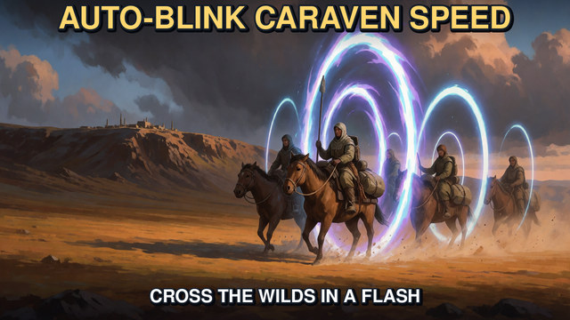

# Auto-Blink Caraven Speed



**Experimental candidate: not release-ready or verified in game.** When every walking caravan member has an AutoBlink source, travel ticks are multiplied by 0.001, rounded to the nearest tick (midpoints away from zero), and clamped to at least one tick. Empty groups, shuttles and results of one tick or less are unchanged. Animals and other walkers count too; passengers allocated a carrier do not. This does not teleport pawns on the world map.

Requires RimWorld 1.7, [Harmony](https://steamcommunity.com/sharedfiles/filedetails/?id=2009463077) (`brrainz.harmony`) and [AutoBlink](https://steamcommunity.com/sharedfiles/filedetails/?id=3493889625) (`rabiosus.autoblink`), loaded first. AutoBlink Gene and Phasecore are optional. Capability means an active, profile-bearing source, **not** permission to blink right now: toggles, cooldowns, costs and other restrictions are not checked. Suppressed genes do not count. See [compatibility and limitations](docs/compatibility.md).

## Build, test, package (source checkout only)

These commands are for a full source checkout, not for the distributed candidate ZIP. The ZIP intentionally does not contain source, tests, or packaging tools. The planned repository URL is https://github.com/rabiosus/auto-blink-caraven-speed (planned, not confirmed live); obtain a source checkout from the project maintainer when available.

Use the .NET 10 SDK and obtain your own compatible game and mod references; they are not redistributed here. In the source checkout, place `Assembly-CSharp.dll`, `RimWorld.dll`, `UnityStubs.dll`, `0Harmony.dll`, and `AutoBlink.dll` in sibling `../auto-blink-caraven-speed-refs`.

```sh
dotnet build Source/AutoBlinkCaravenSpeed.csproj -c Release
dotnet run --project tests/tests.csproj -c Release
python3 tools/package.py
```

The packaging script checks for an existing mod DLL but does **not** build it or run tests. Its zip is a candidate, not a release. Rebuild and test current source before packaging; complete integration and isolated in-game acceptance gates before release or installation. No live game, save, or configuration testing is claimed.

Own code is MIT licensed; see [LICENSE](LICENSE). Artwork provenance is in [docs/art-provenance.md](docs/art-provenance.md). Game and dependency files are separate and not included.
