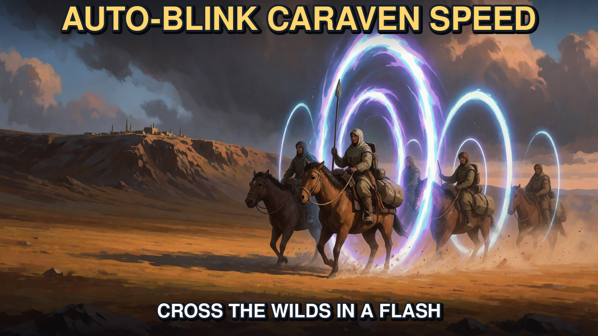

# Auto-Blink Caraven Speed

**Experimental candidate — not verified in game.** Eligible caravans use 0.001× the normal travel ticks, rounded and clamped to at least one tick. All walking members, including animals, need an active profile-bearing AutoBlink source. Requires RimWorld 1.7, Harmony, and AutoBlink.

[Compatibility and limitations](compatibility.html) · [Artwork provenance](art-provenance.html)

[Download experimental candidate ZIP](https://github.com/ErtzFiend/rimworld-auto-blink-caraven-speed/raw/refs/heads/main/dist/Auto-Blink-Caraven-Speed-CANDIDATE.zip) · [Source repository](https://github.com/ErtzFiend/rimworld-auto-blink-caraven-speed)
